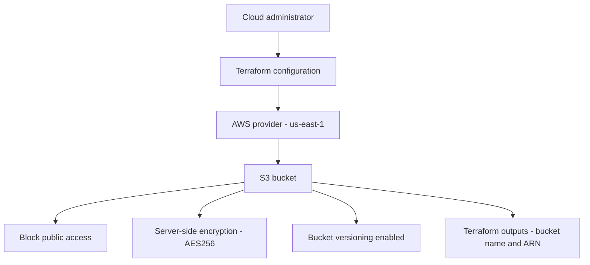
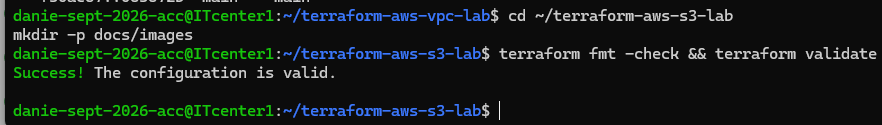

# AWS S3 Security Lab with Terraform

## Project Overview

This project demonstrates provisioning an Amazon S3 bucket with
Terraform. It focuses on Infrastructure as Code, secure storage
defaults, object versioning, encryption, and resource tagging.

This is a learning project for AWS Cloud System Administration.

## Technology Stack

- Amazon Web Services (AWS)
- Amazon S3
- Terraform
- HashiCorp AWS provider
- Ubuntu Linux CLI

## AWS Configuration

- Region: us-east-1 (Northern Virginia)
- Bucket naming: generated using the prefix `terraform-ubuntu-lab-`
- Public access: blocked
- Server-side encryption: AES256 (SSE-S3)
- Versioning: enabled
- Default tags:
  - Project: terraform-learning-lab
  - Environment: practice
  - ManagedBy: Terraform

## Security Controls

### Block Public Access

The configuration blocks public ACLs and bucket policies and
restricts public bucket access.

### Server-Side Encryption

The bucket uses Amazon S3 server-side encryption with AES256
to encrypt object data at rest.

### Versioning

Bucket versioning is enabled to preserve previous versions of
objects when supported changes or deletions occur.

## Repository Contents

- `main.tf` — Terraform configuration for the S3 bucket and security settings
- `.terraform.lock.hcl` — selected provider dependency versions
- `.gitignore` — excludes local Terraform state and sensitive files
- `README.md` — project documentation

## Prerequisites

- Terraform 1.5.0 or newer
- An AWS account
- AWS credentials configured securely outside this repository
- IAM permissions to manage the resources defined in `main.tf`

## Validate the Configuration

Initialize Terraform:

    terraform init

Format the configuration:

    terraform fmt

Validate the configuration:

    terraform validate

Preview changes before making them:

    terraform plan

Review the plan carefully before running `terraform apply`.

## Terraform Outputs

- `s3_bucket_name` — name of the S3 bucket
- `s3_bucket_arn` — ARN of the S3 bucket

## Cleanup and Cost Awareness

Review the Terraform plan before changing or deleting resources.
S3 storage, requests, and retained object versions may incur charges.

Do not run `terraform destroy` unless you understand which resources
the current Terraform state manages and have backed up any data
you need to retain.

## Security Notes

- Do not commit AWS credentials or private SSH keys.
- Do not commit Terraform state files or secret variable values.
- Keep AWS credentials outside this repository.
- Public access is intentionally blocked in this project.

## Future Improvements

- Add input variables for the region and bucket prefix.
- Add lifecycle rules to manage older object versions.
- Add logging and monitoring where appropriate.
- Add automated Terraform formatting and validation to CI/CD.

## Architecture Diagram

This diagram represents the S3 resources defined in the Terraform configuration. It describes the intended configuration, not proof that resources are deployed in AWS.

## Validation Screenshot

This screenshot documents the Terraform validation result. Validation does not prove that the S3 bucket was deployed successfully.
