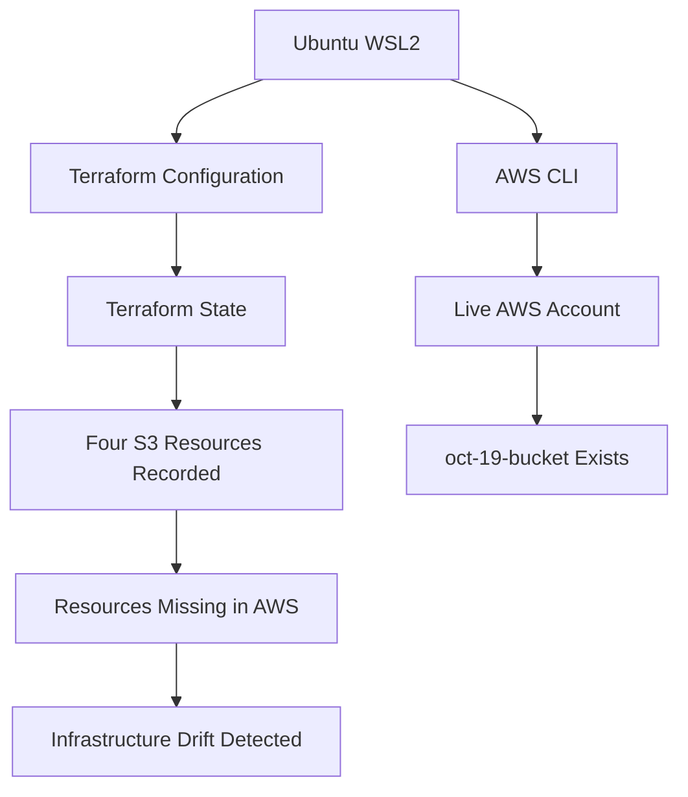

# Terraform S3 Infrastructure Drift Report

## Project
AWS S3 Security Lab with Terraform
Region: us-east-1

## Objective
Detect differences between Terraform state and AWS.

## Terraform Resources
- aws_s3_bucket.lab
- aws_s3_bucket_public_access_block.lab
- aws_s3_bucket_server_side_encryption_configuration.lab
- aws_s3_bucket_versioning.lab

## Recorded Bucket
terraform-ubuntu-lab-5214f8f2156cfd7c3af50e15d4

## AWS Verification Results
- HeadBucket: 404 Not Found
- Public access block: NoSuchBucket
- Encryption: NoSuchBucket
- Versioning: NoSuchBucket
- Existing bucket: oct-19-bucket

## Terraform Validation
- terraform fmt -check: Passed
- terraform validate: Passed
- terraform plan -refresh-only: Drift detected
- Four resources reported deleted outside Terraform
- No Terraform apply performed

## Security and Cost
- Do not commit Terraform state or credentials.
- Review plans before applying changes.
- Keep S3 public access restricted.
- Monitor AWS storage and request costs.

## Status
Drift confirmed. No AWS resources recreated.
Terraform state has not been reconciled.

## Next Steps
- Add a Mermaid architecture diagram.
- Capture a real terminal screenshot.
- Update the main README.
- Review and commit documentation.

## Infrastructure Drift Architecture

This diagram describes the verified state mismatch.
